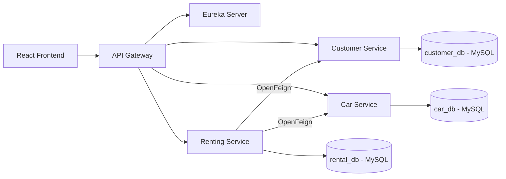

# FU Car Renting System - HE181659

Hệ thống quản lý thuê xe được xây dựng theo kiến trúc microservices với Spring Boot, Spring Cloud, MySQL, Docker Compose và React.

## Kiến trúc hệ thống



| Thành phần | Vai trò | Cổng |
|---|---|---:|
| Frontend | React/Vite client | 5173 |
| API Gateway | JWT, authorization và load-balanced routing | 8088 |
| Eureka Server | Service discovery | 8761 |
| Customer Service | Customer, profile và authentication | 8081 nội bộ |
| Car Service | Xe, hãng, nhà cung cấp và reservation | 8082 nội bộ |
| Renting Service | Giao dịch thuê xe và Saga orchestrator | 8083 nội bộ |

Mỗi microservice chỉ truy cập database của chính nó. Giao tiếp liên service dùng Eureka, OpenFeign và Spring Cloud LoadBalancer.

## Database per Service

Hệ thống dùng ba MySQL 8.4 container độc lập.

| Service | Database | Host port | Username | Password |
|---|---|---:|---|---|
| customer-service | `customer_db` | 3311 | `root` | `root` |
| car-service | `car_db` | 3312 | `root` | `root` |
| renting-service | `rental_db` | 3313 | `root` | `root` |

Các container dùng volume riêng để lưu dữ liệu sau khi khởi động lại.

## Saga Pattern

Quy trình tạo giao dịch thuê xe dùng orchestration Saga.

1. Renting Service xác minh khách hàng qua Customer Service.
2. Renting Service tạo `sagaId` và giao dịch cục bộ ở trạng thái `PENDING`.
3. Car Service giữ từng xe theo khoảng ngày, dùng pessimistic lock và kiểm tra trùng lịch.
4. Renting Service tính giá và lưu giao dịch trong `rental_db`.
5. Admin xác nhận để chuyển reservation sang `CONFIRMED`.
6. Khi từ chối hoặc hủy, compensating action giải phóng lịch xe.
7. Admin giao xe, nhận xe trả và hoàn tất giao dịch.

Các endpoint Saga nội bộ nằm dưới `/internal/cars/sagas/{sagaId}` và không được API Gateway công khai.

## Chạy toàn bộ hệ thống bằng Docker

Từ thư mục gốc của project, chạy một lệnh duy nhất.

```powershell
docker compose -f backend/docker-compose.yml up --build
```

Các địa chỉ sau sẽ sẵn sàng sau khi container chuyển sang trạng thái healthy.

- Frontend http://localhost:5173
- API Gateway http://localhost:8088
- Eureka Dashboard http://localhost:8761

Dừng hệ thống nhưng giữ dữ liệu MySQL.

```powershell
docker compose -f backend/docker-compose.yml down
```

Xóa cả container và dữ liệu MySQL.

```powershell
docker compose -f backend/docker-compose.yml down -v
```

## Chạy development

Khởi động ba MySQL database và Eureka. Sau đó chạy mỗi lệnh Spring Boot trong một terminal riêng.

```powershell
docker compose -f backend/docker-compose.yml up -d customer-db car-db rental-db eureka-server
cd backend
.\mvnw.cmd -pl customer-service spring-boot:run
.\mvnw.cmd -pl car-service spring-boot:run
.\mvnw.cmd -pl renting-service spring-boot:run
.\mvnw.cmd -pl api-gateway spring-boot:run
```

Mở terminal khác để chạy frontend.

```powershell
cd frontend
npm install
npm run dev
```

## Build

```powershell
cd backend
.\mvnw.cmd clean package -DskipTests

cd ..\frontend
npm install
npm run build
```

## Tài khoản mẫu

| Quyền | Tài khoản | Mật khẩu |
|---|---|---|
| Admin | `admin` | `admin` |
| Customer | `customer1@gmail.com` | `123456` |

## API chính

- `POST /api/auth/login`
- `POST /api/customers/register`
- `GET|PUT /api/customers/profile`
- `GET|POST /api/cars`
- `GET /api/cars/available?startDate=YYYY-MM-DD&endDate=YYYY-MM-DD`
- `GET /api/cars/{id}/schedule` dành cho Admin
- `POST /api/rentings`
- `GET /api/rentings/my-history`
- `GET /api/rentings/{id}`
- `PATCH /api/rentings/{id}/cancel`
- `PATCH /api/rentings/{id}/confirm|reject|deliver|complete` dành cho Admin
- `GET /api/rentings/report?startDate=YYYY-MM-DD&endDate=YYYY-MM-DD`

Vòng đời chuẩn là `PENDING → CONFIRMED → RENTING → COMPLETED`. Các nhánh kết thúc sớm gồm `REJECTED` và `CANCELLED`.

Tất cả API client gọi qua API Gateway. Có thể đổi cổng máy bằng biến môi trường `API_GATEWAY_PORT`. Cổng Gateway trong Docker network luôn là `8080`.

## Nguồn ảnh xe mẫu

Ảnh xe mẫu được tải trực tiếp từ Wikimedia Commons và hiển thị qua trường `imageUrl`. Các ảnh đều là ảnh chụp thực tế; xem trang nguồn để biết tác giả và điều khoản giấy phép tương ứng.

| Xe mẫu | Nguồn ảnh |
|---|---|
| Toyota Vios 2022 | [JamesYoung8167 – Wikimedia Commons](https://commons.wikimedia.org/wiki/File:Toyota_Vios_XP150_Facelift_Shishi_02_2022-09-20.jpg) |
| Honda City 2023 | [Ethan Llamas – Wikimedia Commons](https://commons.wikimedia.org/wiki/File:Honda_City_1.5_S_2023.jpg) |
| Mazda 3 2024 | [Wikimedia Commons](https://commons.wikimedia.org/wiki/File:2024_Mazda3_%28BP%29_G20_Evolve_sedan,_Verdun,_South_Australia_2024-03-07.jpg) |
| Toyota Corolla Cross 2024 | [Captainmorlypogi1959 – Wikimedia Commons](https://commons.wikimedia.org/wiki/File:Toyota_Corolla_Cross_1.8_V_Hybrid_2024_%281%29.jpg) |
| Kia Carnival 2023 | [Ethan Llamas – Wikimedia Commons](https://commons.wikimedia.org/wiki/File:Kia_Carnival_2.2_SX_2023_%281%29.jpg) |
| Ford Everest 2022 | [Chanokchon – Wikimedia Commons](https://commons.wikimedia.org/wiki/File:2022_Ford_Everest_Sport_2.0L_Turbo_4x2.jpg) |
| Honda CR-V 2021 | [Wikimedia Commons](https://commons.wikimedia.org/wiki/File:2021_Honda_CR-V_1.5_Turbo_Prestige_%28front_right%29,_Central_Surabaya.jpg) |
| Toyota Innova 2020 | [Captainmorlypogi1959 – Wikimedia Commons](https://commons.wikimedia.org/wiki/File:Toyota_Innova_2.8_V_2020.jpg) |
